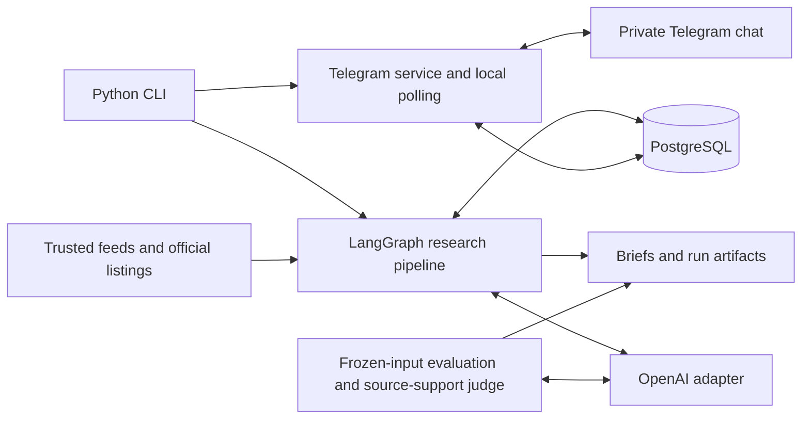

# Daily Tech Upgrade Agent

A personal technical-reading companion that finds trusted articles, ranks them for your
interests and experience, and prepares a brief of up to **three articles within 20 minutes
of estimated reading**. Read it locally or receive it in your private Telegram chat.

- Source-grounded summaries, technical insights, original links, and relevance explanations.
- Persistent preferences with explicit confirmation, corrections, and forgetting.
- Article likes/dislikes and reasons that inform future recommendations.
- PostgreSQL history, repeat filtering, and delivery tracking that avoids resending confirmed messages.
- Frozen-input evaluation with human usefulness ratings and automated source-support estimates.

**Current status:** Runs locally. Hosted webhooks, daily scheduling, and web-search fallback
are planned. See the [project plan](DailyTechUpgradeAgent_Project_Plan.md) and [known issues](ISSUES.md).

## Quick start

Requires **Python 3.11+** and **Docker with Compose**. Run from the repository root.

```sh
python3 -m venv .venv
.venv/bin/python -m pip install -e '.[dev]'
cp -n .env.example .env
```

Configure `.env` locally; keep any existing credentials:

| Variable | Purpose |
| --- | --- |
| `OPENAI_API_KEY`, `OPENAI_MODEL` | Generation and natural-language preference interpretation |
| `POSTGRES_PASSWORD` | Choose before starting the database for the first time |
| `DATABASE_URL` | Use the same password, URL-encoded, in the example connection URL |
| `TELEGRAM_BOT_TOKEN`, `TELEGRAM_CHAT_ID` | Optional Telegram setup: BotFather token and your verified private chat ID |

```sh
docker compose up -d --wait db
.venv/bin/daily-tech --db-migrate
.venv/bin/daily-tech
```

Each run writes `output/<timestamp>/brief.md` and `run.json` with sources, evidence, diagnostics,
and usage. Runs also persist in PostgreSQL by default. `.env`, generated output, and
`config/profile.json` are ignored by Git.

To try discovery **without an API key or database**:

```sh
.venv/bin/daily-tech --discover-only --no-db
```

The initial profile comes from `config/profile.example.json`; later runs use the stored profile.
To customize it, copy the example to `config/profile.json`, edit it, and import it:

```sh
.venv/bin/daily-tech --import-profile config/profile.json
```

## Telegram

Create a bot with BotFather, send it `/start`, and configure its token and your private chat ID
in `.env`. The listener accepts messages only from the configured private chat and sender.

```sh
.venv/bin/daily-tech --telegram-check     # Verify bot identity; sends nothing
.venv/bin/daily-tech --send-brief         # Send the latest saved brief
.venv/bin/daily-tech --telegram-listen    # Keep running; stop with Ctrl+C
```

`/brief` retrieves the latest saved brief; it does not generate a new one. Generate a fresh
brief with `.venv/bin/daily-tech`, then send it. Keep Docker and the listener running for interaction.

| In the bot chat | Action |
| --- | --- |
| `/start`, `/brief`, `/profile` | Help, latest brief, effective reading profile |
| `/preferences` | Inspect saved preferences and their evidence |
| `/remember TEXT` | Propose a preference without a model call |
| `/confirm P2`, `/reject P2` | Accept or reject a proposal |
| `/replace P1 TEXT` | Propose a correction to an existing preference |
| `/forget P2` | Stop applying a preference; historical briefs remain |
| Like/Dislike buttons | Save feedback for that article and return an F number |
| `/reason F3 TEXT` | Attach a reason to that feedback |

Use the IDs returned by your bot. You can also send a natural-language preference such as
“Prefer tutorials with runnable code examples,” then confirm the proposal. A dislike alone
does not create a permanent topic ban.

## Evaluation

```sh
.venv/bin/daily-tech --eval-freeze                         # Prints a snapshot path
.venv/bin/daily-tech --eval-replay PATH_TO_SNAPSHOT_JSON    # Prints an attempt directory
.venv/bin/daily-tech --eval-judge PATH_TO_ATTEMPT_DIRECTORY --runtime-seconds 600
.venv/bin/daily-tech --eval-report PATH_TO_ATTEMPT_DIRECTORY
```

Replace path placeholders with the printed paths. Replay compares generic and personalized
selection using the same saved article pool. Rate usefulness from 1–5 in the attempt's
`review.json`; inspect results in `report.md` and `metrics.json`.

The automated judge estimates support from saved sources and flags statements for optional
spot-checks. Its versioned verdicts and evidence live under `judges/`; human labels stay separate.
**Source support is not verified factual accuracy.** Full manual claim review is optional for v1.
Replay and judging make paid model calls; report regeneration is local. Evaluation never sends
Telegram messages or changes production profiles/history.

## Tests

```sh
.venv/bin/pytest -q
.venv/bin/ruff check .
.venv/bin/ruff format --check .
```

Database integration tests run when `TEST_DATABASE_URL` is set; otherwise they are skipped:

```sh
TEST_DATABASE_URL='YOUR_TEST_DATABASE_URL' .venv/bin/pytest -q
```

Use a PostgreSQL role allowed to create temporary test schemas. Tests mock model and Telegram
requests; they do not require API keys or send messages.

## Command reference

All flags below follow `.venv/bin/daily-tech`. See `--help` for the complete interface.

| Flag | Purpose |
| --- | --- |
| `--discover-only` | Fetch articles without model calls |
| `--no-db` | Run generation/discovery using files only |
| `--days 30` | Change the publication lookback; default is 7 days |
| `--model NAME`, `--runtime-seconds 300` | Override model or workflow time budget |
| `--sources FILE`, `--output DIRECTORY` | Override source configuration or output location |
| `--show-profile`, `--preferences` | Inspect the effective profile or saved memories |
| `--history`, `--show-run RUN_UUID` | Inspect recent runs or a stored brief |
| `--telegram-deliveries` | Inspect delivery status, including uncertain outcomes |

<details>
<summary>Additional maintenance and evaluation commands</summary>

| Flag | Purpose |
| --- | --- |
| `--db-migrate` | Apply pending SQL migrations |
| `--import-profile FILE` | Replace the stored base profile |
| `--profile FILE` | Save a profile before a normal run; invocation-only with `--no-db` |
| `--import-run FILE` | Import an earlier `run.json` idempotently |
| `--allow-repeats` | Permit previously recommended articles for testing |
| `--send-brief RUN_UUID` | Deliver a specific stored brief |
| `--telegram-poll-once` | Process one batch of pending updates |
| `--telegram-feedback-buttons` | Add buttons to older delivered articles; stop the listener first |
| `--remember-preference TEXT --preference-evidence TEXT` | Import a preference explicitly confirmed outside Telegram |
| `--eval-freeze RUN_UUID_OR_JSON` | Freeze a specific stored run or saved file |
| `--eval-replay SNAPSHOT --eval-corrected-profile FILE` | Add a corrected-profile comparison |
| `--eval-add-corrected BASELINE_DIR --eval-corrected-profile FILE` | Preserve baseline outputs and run only the corrected condition |
| `--eval-replay SNAPSHOT --eval-seed-review REVIEW_JSON` | Carry human article ratings from the same frozen corpus |

Set `OPENAI_JUDGE_MODEL` or use `--model NAME` to select another judge model. Editorial code
changes require exporting a new snapshot before replay. Each replay/judge attempt preserves
previous results.

</details>

## Architecture



`retrieval.py` handles discovery/verification; `editorial.py` handles ranking/summaries;
`preferences.py` handles memory/feedback; `telegram_*.py` handles interaction/delivery;
`evaluation*.py` handles isolated evaluation. PostgreSQL holds profiles, evidence, runs,
recommendations, and delivery state.

The app may return fewer than three articles when quality, access, diversity, or history
constraints cannot be met. Uncertain Telegram sends are held for inspection rather than
automatically resent. Exit codes: `0` success, `2` partial/no readable discovery results,
`1` failure. `docker compose down` stops PostgreSQL while preserving its volume; adding `-v`
deletes its data. Changing `.env` alone does not change an initialized database's password.
